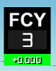
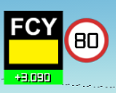
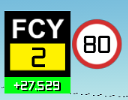
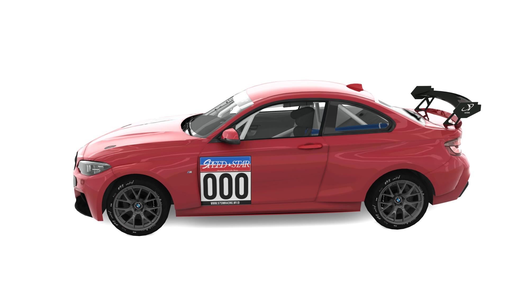
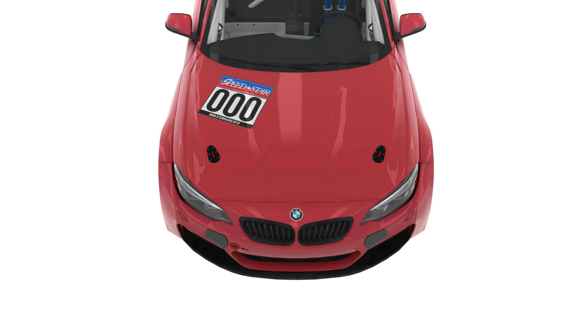

# Speed Star Championship 2026 — Sporting Regulations

## Table of Contents

- [CHAPTER I — Introduction](#chapter-i--introduction)
- [CHAPTER II — Racing Rules](#chapter-ii--racing-rules)
- [CHAPTER III — Livery Regulations](#chapter-iii--livery-regulations)
- [CHAPTER IV — Violations and Penalties](#chapter-iv--violations-and-penalties)
- [Glossary](#glossary)

---

# CHAPTER I — INTRODUCTION

## 1. Overview

The Speed Star Championship is a virtual racing competition using the **BMW M240i CUP**, organized by 97 Sim Racing Community. This esports competition takes place in Assetto Corsa, a racing simulation game developed by Kunos Simulazioni. The championship uses a sprint race format.

## 2. Competition

### 2.1. Race Calendar

The race calendar for Speed Star Championship 2026 is as follows:

| Round | Date | Circuit | Time |
| --- | --- | --- | --- |
| 1 | 6 November 2026 | Red Bull Ring, Austria | 20:00 UTC+7 |
| 2 | 20 November 2026 | Laguna Seca, United States | 20:00 UTC+7 |
| 3 | 4 December 2026 | Bathurst, Australia | 20:00 UTC+7 |
| 4 | 18 December 2026 | Interlagos, Brazil | 20:00 UTC+7 |

*The schedule may change depending on circumstances.*

### 2.2. Race Car

The car used in this competition is the BMW M240i CUP by ACF.

### 2.3. Race Format

Speed Star Championship 2026 uses a sprint race format. Each race lasts **30 minutes**.

## 3. Driver Eligibility

To take part in the competition, drivers must meet these requirements:

1. Drivers must own Assetto Corsa with all DLCs.
2. Drivers must have a stable internet connection with a maximum ping of **300 ms**.
3. Drivers must have at least a basic understanding of racing rules.

## 4. Championship Title

The Speed Star Championship title will be awarded to the driver who earns the most points over the season.

## 5. Registration and Schedule

### 5.1. Registration

Drivers may take part in every round, several rounds, or just one round.

### 5.2. Racing Numbers

Every driver must have a racing number between **1 and 999**. Once a number has been chosen by a driver, no other driver may use it.

### 5.3. Race Week Schedule

Registration and livery submissions for each round will open one week before race week.

GUID-locked free practice sessions and ballast settings will be available for three days during race week. Qualifying and the race will take place on Friday. A pre-qualifying session will be held if registrations exceed the available entry slots.

Pre-qualifying may take place on Thursday.

## 6. Points

Drivers will receive points after each race based on their finishing positions, as shown below.

**Points System**

| Position | Points |
| --- | ---: |
| 1st | 25 |
| 2nd | 18 |
| 3rd | 15 |
| 4th | 12 |
| 5th | 10 |
| 6th | 8 |
| 7th | 6 |
| 8th | 4 |
| 9th | 2 |
| 10th | 1 |
| Pole Position | 1 |
| Fastest Lap (FL) | 1 |

### 6.1. Detailed Points Rules

1. No points will be awarded if the race leader has completed fewer than two laps.
2. If the race leader has completed at least two laps but less than 75% of the scheduled race time, only half points will be awarded.
3. Full points will be awarded if the race leader has completed more than 75% of the scheduled race time.
4. A driver who does not finish (DNF) but is in a points-paying position and has completed 70% of the total race time is eligible to receive points based on their final classification.
5. If two or more drivers have the same number of points at the end of the season, their positions in the standings will be decided by their best finishing results.

## 7. Publication

Race results and the overall championship standings will be published on the 97 Sim Racing Community Instagram account. Drivers who post about this competition on social media may use **#97SSC2026**.

---

# CHAPTER II — RACING RULES

The following rules apply to Speed Star Championship 2026. All drivers must read and follow them.

## 1. Driver Briefing

All drivers must attend the briefing, which will take place **one hour before qualifying and the race**. The briefing explains the racing rules and any additional rules for that round. The organizers will provide briefing notes before the briefing starts.

## 2. Practice Session

Practice sessions will be available for three days during race week. These sessions allow teams and drivers to find suitable car setups.

## 3. Pre-Qualifying Session

Pre-qualifying will be held when the number of registered drivers exceeds the available entry slots. It will take place on Thursday and last **two hours**. Drivers must set their fastest lap times to qualify for the next session. Only **30 drivers** will advance.

Pre-qualifying will use a single-qualifying format on the server.

## 4. Qualifying Session

Qualifying will take place on the same day as the race. It determines the starting grid. Each driver will have **10 minutes** to set their fastest lap time.

## 5. Race Session

The race is the main session of the competition. Each round includes **one 30-minute race**. Starting positions are based on qualifying results.

### 5.1. Starting Procedure

The race will use a **standing start**. Drivers may start racing when the starting lights go out.

### 5.2. Racing Procedures

1. Drivers racing close to another car must leave enough space for that car.
2. Drivers may change their racing line only once to defend their position. Changing lines more than once is considered *weaving* and will result in a penalty.
3. Drivers who cause an incident and gain an advantage from it must give the gained position back to the driver who was affected, even without being told to do so.

### 5.3. Crashes and Leaving the Track

1. When a car crashes on or near the track, other drivers passing the area must slow down, watch their surroundings, and must not overtake.
2. Before rejoining the track, drivers must make sure it is safe and that no other cars are approaching.
3. Drivers must not cross the racing line when rejoining the track. They must rejoin from outside the racing line.
4. Drivers whose cars are seriously damaged must enter the pits and may repair their cars.
5. If a car is so badly damaged that it cannot be driven, the driver will be classified as DNF and may not continue the race.

### 5.4. Blue Flag

1. A blue flag is shown to a driver who is about to be passed by a car that has completed more laps.
2. Drivers shown a blue flag must allow the car with more completed laps to pass.
3. Drivers who ignore blue flags will receive a time penalty decided by the organizers.

### 5.5. Full Course Yellow (FCY)

1. Full Course Yellow may be used when a problem on the track prevents the race from continuing normally.
2. If two drivers are side by side just before FCY is deployed, the driver whose front bumper is ahead of the other car's front bumper is entitled to the position in front during FCY.
3. Drivers are not allowed to enter the pit area while FCY is active.
4. The FCY procedure is explained in the table below.

| Indicator | Explanation |
| --- | --- |
|  | **FULL COURSE YELLOW DEPLOY** — Prepare to slow down safely. When the countdown reaches zero, your speed must be **80 km/h**. |
|  | Keep your time delta in the green zone and maintain **80 km/h**. Overtaking other cars is not allowed. |
|  | **FULL COURSE YELLOW ENDING** — A countdown will appear. Keep your time delta in the green zone and stay at **80 km/h**. If you exceed 80 km/h before the countdown reaches zero, you will receive a penalty. |
|  | **Green!** You may resume racing. |

### 5.6. Race Suspension and Resumption

A race may be suspended if the server has technical problems. The race will resume once the server is stable, using the running order from **one lap before** the server problem occurred.

If the server cannot be used and no replacement server is available, the race will be stopped and considered finished. The final results will be based on the running order from one lap before the server problem.

### 5.7. Finish

The end-of-race signal will be given when the leading car crosses the finish line after the scheduled race time has ended.

After the end-of-race signal, drivers who cross the finish line must return to the pits without delay by completing one more lap.

### 5.8. Ballast System

1. The championship uses a ballast system. Each driver's points are multiplied by **0.8**, and the result is rounded up to determine the ballast weight. The maximum ballast is **65 kg**.
2. The ballast system starts from **Round 2**.
3. In each round, ballast applies from the pre-qualifying session onward.

### 5.9. Other Rules

1. Drivers must not crash into other cars after qualifying or the race has ended. They may complete one additional lap to return to the pits or use the *Back to Pit* option immediately.
2. Drivers and teams must treat each other with respect throughout the competition. Insults, bullying, and any other behavior that harms relationships between drivers or teams are not allowed.

---

# CHAPTER III — LIVERY REGULATIONS

The following livery rules apply to Speed Star Championship 2026. All participants must read and follow them.

## 1. Livery Template

The organizers will provide a livery template and livery icons. The template will be provided as a `.psd` file that drivers can use.

## 2. Folder Naming

Livery folders must follow this naming format:

```text
97_SSC_[Number]_[Name]
```

Example:

```text
97_SSC_79_John_Doe
```

*Do not use spaces in folder names. Use underscores (`_`) instead.*

## 3. Racing Numbers on the Livery

The following rules apply to racing numbers:

1. The number plate will be provided by the organizers; participants only need to change the number section. The font used must be the one provided by the organizers, which is **Bebas Font**.
2. Racing numbers must use standard Arabic numerals: **0, 1, 2, 3, 4, 5, 6, 7, 8, and 9**.
3. Racing numbers must be placed on the front of the car and on both sides of the rear wing.
4. See the images below for racing number placement.

| Left and Right Sides | Front |
| --- | --- |
|  |  |

## 4. `ui_skin.json` File

The `ui_skin.json` file must include the following information:

```json
{
  "skinname": "livery folder name",
  "country": "country name",
  "drivername": "driver name",
  "team": "team name",
  "number": "driver's racing number"
}
```

Example:

```json
{
  "skinname": "97_SSC_79_Nawasapta_Team",
  "country": "United Kingdom",
  "drivername": "John Doe",
  "team": "Nawasapta Team",
  "number": "79"
}
```

## 5. Livery Resolution and Folder Size

Livery images must use the template resolution of **4096 × 4096 pixels**. The maximum livery folder size is **100 MB**.

## 6. Mandatory Stickers

Stickers included in the template must not be changed, removed, or moved, except for the racing number.

## 7. Livery Content

All liveries must follow these content rules:

1. Liveries must not contain content that insults or discriminates against people based on ethnicity, religion, race, or social groups.
2. Liveries must not contain explicit content.
3. Liveries must not contain any other inappropriate or indecent content.

## 8. Livery Submission

The rules for livery submissions are as follows:

1. There is no restriction on how early a livery may be submitted.
2. Liveries must be submitted no later than **one week (7 × 24 hours) before the race** for that round.
3. The organizers have the right to reject submitted liveries.
4. The organizers may explain which parts of a rejected livery must be corrected.
5. Rejected liveries may be corrected and submitted again.
6. If a livery is rejected after the submission deadline, the team will have **one more chance** to submit a corrected livery. If it is rejected again, the team must use a livery provided by the organizers or a livery the team previously used.
7. Teams that do not submit a livery will use a livery provided by the organizers.

## 9. Other Livery Rules

1. The livery folder must not contain an `ext_config` file.
2. The organizers have the right to stop a team from using a livery during the season if it does not meet the regulations.

---

# CHAPTER IV — VIOLATIONS AND PENALTIES

This chapter explains how to report violations, the types of violations, and the penalties that drivers may receive.

## 1. Reporting Violations

If a driver notices a violation during qualifying or the race, they must report it to the organizers through the provided forum.

**Violation Report Format:**

- **Session:** Qualifying / Race
- **Reporting Driver:** John Doe
- **Reported Driver:** Maxine Kane
- **Description:** …
- **Video:** Submit a trimmed `.acreplay` replay file showing the incident during qualifying or the race.

*Replay files must use this naming format: `round_session_violation.acreplay`. Reports with incorrect file names will not be accepted.*

Reports about incidents during the race must be submitted within **24 hours after the race ends**. Any violations found during a post-race investigation will receive an appropriate penalty.

Drivers must submit their own reports. Another driver may not report an incident on their behalf.

A reported driver may appeal the report by providing an explanation.

Once a violation report has been submitted, it cannot be deleted or withdrawn.

## 2. Penalty Points

Drivers who receive penalties will also receive penalty points. This system helps maintain fair and orderly racing.

Penalty points are given as follows:

1. Every **5 seconds of time penalty**, or a **drive-through penalty**, results in **2 penalty points**.
2. A **stop-and-go penalty** or **lap deduction** results in **4 penalty points**.
3. **Disqualification** results in **6 penalty points**.

Drivers will receive warnings or sanctions based on their total penalty points:

1. At **8 penalty points**, a driver receives a **first warning**.
2. At **10 penalty points**, a driver receives a **second warning**.
3. At **13 penalty points**, a driver receives a **one-race ban** and is not allowed to compete in one race.

## 3. List of Violations

The following violations carry these penalties:

### Article 1

| Violation | Minimum Penalty | Maximum Penalty |
| --- | --- | --- |
| a. Causing a collision that negatively affects another driver. | +10 seconds | +20 seconds |
| b. Causing a chain-reaction collision that affects several drivers. | +60 seconds | +120 seconds |
| c. Deliberately crashing into another driver in a dangerous manner. | Disqualification | — |
| d. Causing an incident due to warping. | Disqualification | — |

### Article 2

| Violation | Minimum Penalty | Maximum Penalty |
| --- | --- | --- |
| a. Rejoining the track unsafely and interfering with another driver. | +10 seconds | +30 seconds |
| b. Rejoining the track unsafely and causing a collision with another driver. | +30 seconds | +60 seconds |
| c. Rejoining the track unsafely and causing an incident involving several drivers. | Disqualification | — |

### Article 3

| Violation | Minimum Penalty | Maximum Penalty |
| --- | --- | --- |
| a. Failing to give another driver enough track space. | +10 seconds | +30 seconds |
| b. Excessive weaving. | +15 seconds | +30 seconds |
| c. Blocking another driver during a blue-flag situation. | +15 seconds | +30 seconds |
| d. Blocking another driver during qualifying. | +10 seconds | +30 seconds |

### Article 4

| Violation | Penalty |
| --- | --- |
| a. Crossing the pit entry or exit lines. | +10 seconds |
| b. Cutting the track more than four times. | Drive-through |
| c. Breaking the FCY procedure. | +20 seconds |
| d. Jump start. | Drive-through |

Drivers involved in arguments outside the track that are related to the race will be required to make a **public apology**.

---

# GLOSSARY

| Term | Definition |
| --- | --- |
| Assetto Corsa | The racing simulation software used as the official platform for the Open Wheel Trophy competition. |
| Arabic Numerals | The numbers 0–9, used as the standard format for racing numbers on cars. |
| Race | The main competitive session in a round, which determines the final results and points awarded to drivers. |
| Ballast | Extra weight added to a car. |
| Blue Flag | A warning shown to a driver who is about to be overtaken by a car that has completed more laps. The driver must allow that car to pass. |
| Crash | An accident involving a racing car that may cause minor or major damage and disrupt the race. |
| DNF (Did Not Finish) | A result given to drivers who cannot complete a race because of technical problems, accidents, or other reasons. |
| Drive Through | A penalty that requires a driver to drive through the pit lane without stopping. |
| FCY (Full Course Yellow) | A period when the entire race is slowed down because of an issue on the track. Drivers must reduce speed and may not overtake. |
| Finish | The finish line or point that officially marks the end of a race. |
| Free Practice | A practice session where drivers can test their cars and adjust their setups. |
| Entry Slots | The maximum number of starting places available to drivers in a race session. |
| Qualifying Session | A session that sets the starting positions based on each driver's fastest lap time. |
| Competition | The Open Wheel Trophy virtual racing event officially organized by 97 Sim Racing Community. |
| Lap | One complete circuit of the race track. |
| Livery | The car's visual design and graphics, which must meet the organizers' rules. |
| Livery Template | A design file provided by the organizers to help participants create their liveries. |
| Mandatory Sticker | A required graphic on the livery that must not be changed, moved, or removed. |
| Formula Regional Car | The Tatuus F3 T-318 racing car specified for the competition. |
| Racing Number | A unique number between 1 and 99 used to identify a driver during the competition. |
| Speed Star Championship | A sprint-format virtual racing competition organized by 97 Sim Racing Community. |
| Overtake | Passing another car in a legal manner under the racing rules. |
| Penalty Point | A point added to a driver's violation record when they break the rules. |
| Pit Box | An area outside the main track where cars may be repaired, serve penalties, or receive technical support. |
| Pre-Qualifying | A selection session held when registrations exceed the available entry slots. It decides who may continue to the next session. |
| Practice | A session where drivers prepare their cars before official sessions. |
| Qualifying | An official session that determines starting positions based on each driver's fastest lap. |
| Race Ban | A penalty that prevents a driver from entering one or more races because of accumulated violations. |
| Racing Line | The ideal path around a track for achieving a fast and efficient lap time. |
| Round | One scheduled race event that includes several sessions. |
| Server | The online system used to run the competition sessions. |
| Single Qualifying | A qualifying format where drivers set lap times individually on the server. |
| Sprint Race | A relatively short race format that focuses on intense racing and quick strategy decisions. |
| Standing Start | A race start where the cars remain stationary until the starting lights go out. |
| Suspended Race | A race that is temporarily stopped because of a technical or server problem and may later be resumed. |
| Track | The official racing circuit, including the areas and boundaries defined by the rules. |
| Track Limits | The boundaries of the circuit that drivers must respect during a race. |
| Timeline | The schedule of activities from registration to the race itself. |
| `ui_skin.json` | A configuration file containing information about the livery, driver, team, country, and racing number. |
| Warping | An internet connection issue that makes a car move unpredictably or appear out of sync on the server. |
| Weaving | Repeated side-to-side movements beyond what is allowed when defending a position. This may result in a penalty. |
